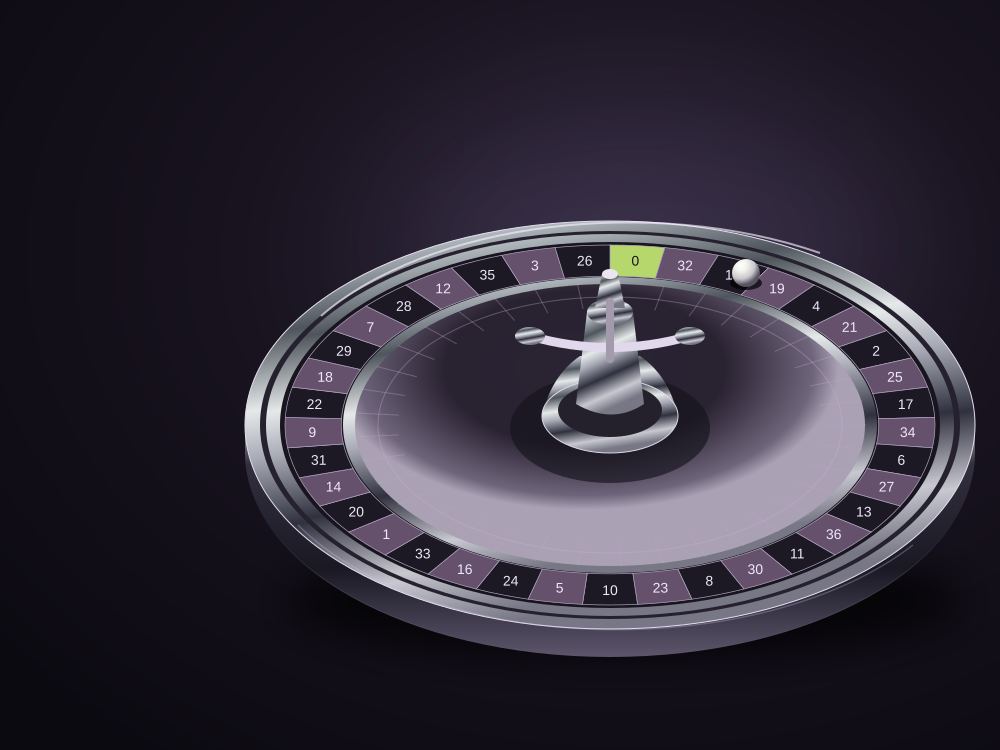

<p align="center">
  
</p>

# ORBIT LIVE

My mobile-first UI/UX concept for a premium casino lobby and practice roulette table.

I built this interactive concept to explore how a game interface can feel expressive while keeping its controls clear. The journey moves from browsing tables to placing a practice bet and following a round, with a shared visual language across mobile, tablet, and desktop.

[Explore the demo](https://jupiter847.github.io/orbit-live/) · [UI system](https://jupiter847.github.io/orbit-live/#components) · [Behind the design](https://jupiter847.github.io/orbit-live/#notes)

## The design challenge

A casino lobby has a lot to communicate: game type, table limits, saved choices, and the next action. I wanted those details to be easy to compare without losing the atmosphere of the game.

The lobby uses consistent cards, game filters, search, and a minimum-limit filter. The practice table puts the wheel, chip selection, total bet, and round state into a more focused layout.

## Explore the prototype

- Browse six tables, filter by game or minimum limit, and sort the results.
- Save tables and return to them through the saved view.
- Open a table overview to check its format and limits.
- Try European single-zero roulette with play credits: choose chips, bet on numbers or red, black, even, and odd, then spin.
- Undo or clear unplayed chips, repeat the last round's bets, and review the result.
- Reset the practice wallet. Credits and saved tables are kept locally in the browser.

Roulette is the interactive game. Blackjack and baccarat are visual table previews with a route back to practice roulette.

## The visual system

Dark surfaces keep the game artwork in focus. Lilac softens the interface, while lime marks important actions and selected controls. Three original SVG illustrations connect roulette, blackjack, and baccarat through layered geometry, chrome, and studio-style lighting.

The [UI system](https://jupiter847.github.io/orbit-live/#components) includes colour, typography, spacing, shape, and interactive examples. Button, chip, save, and round-status examples show how the interface handles selection and feedback. Colour values can be copied, design tokens downloaded as JSON, and the SVG artwork downloaded individually.

## Mobile and interaction details

The lobby changes from one column on mobile to two on tablet and three on desktop. Navigation moves to the bottom on small screens. Roulette becomes a full-screen table with single-number bets expandable to keep the initial controls compact.

Keyboard focus is visible. Dialogs support Escape, contain keyboard focus, and return focus when closed. Round updates are announced to assistive technology, and the interface supports reduced motion. Bets lock while a round is running; leaving a table returns any unplayed chips.

## Built with

React, TypeScript, Vite, CSS, SVG, and Lucide icons. The prototype runs in the browser without a game backend or account system.

### Run locally

Use Node.js 22.13 or later.

```sh
npm install
npm run dev
```

Create a production build:

```sh
npm run build
```

The production files are written to `docs/` for GitHub Pages. The app uses relative asset paths so it can be hosted under the repository URL.


## What I would explore next

- Test whether first-time players understand the controls and round states.
- Review contrast, navigation, and text sizing on more devices and with a wider range of users.
- Extend the same system into a complete blackjack flow.
- Develop editable design files and a detailed production handoff.

---

An independent portfolio concept by **Janina**. The casino theme is fictional, outcomes are simulated, and play credits have no monetary value. There is no real streaming, real-money betting, or affiliation with Playtech or any casino.
